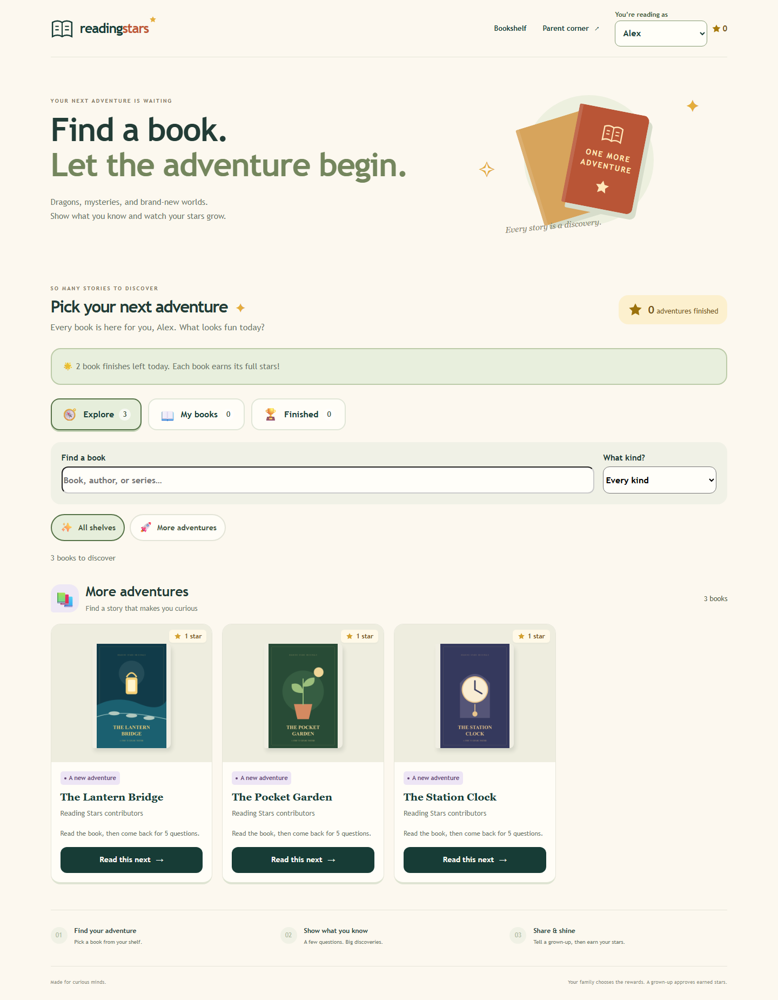
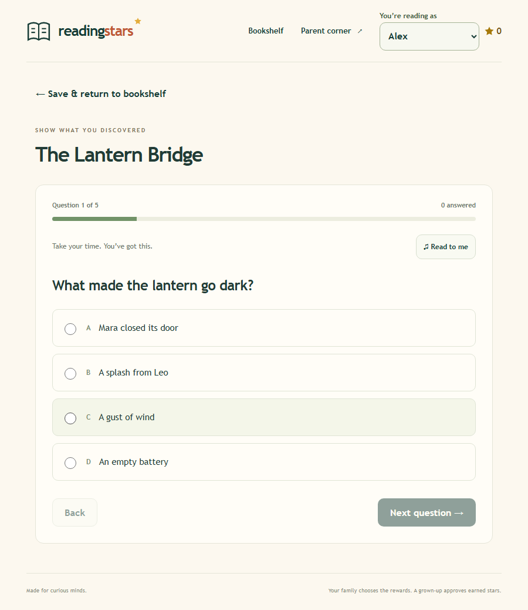
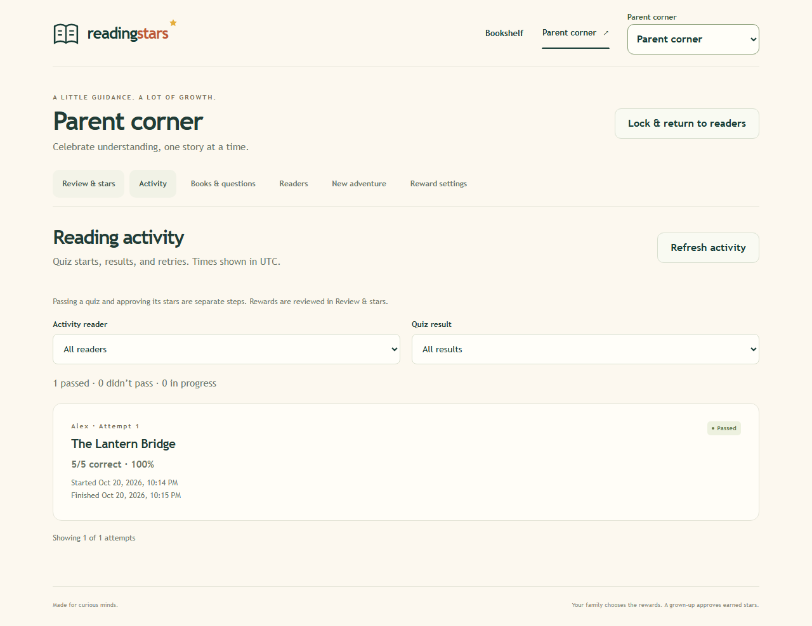
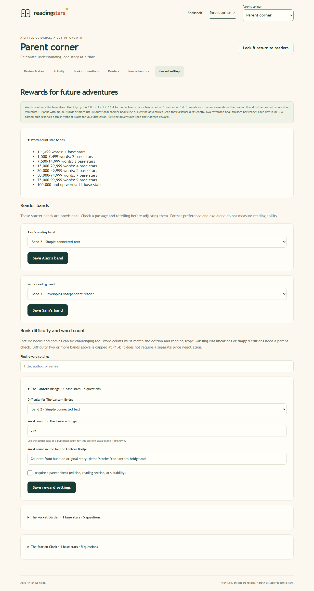

# Reading Stars

**Read a book. Understand the story. Celebrate the progress.**

[](https://github.com/EzekielTheMad/reading-stars/actions/workflows/ci.yml)
[](LICENSE)

Reading Stars is a small, self-hosted reading comprehension and rewards app for families. Children read their own books, take a short quiz, and discuss what they understood with a grown-up before earning stars. Your family decides what those stars mean.



## What it does

- A shared bookshelf with covers, series shelves, search, and book-type filters.
- An explicit reader picker, separate progress for each child, and saved quizzes.
- Parent-reviewed questions with shuffled answer choices and PIN-controlled retries.
- Word-count rewards adjusted for each reader's difficulty band. Agreed rewards stay fixed.
- Five questions for shorter books; ten at 50,000+ words. Passing requires 80%.
- Two rewarded book finishes per reader per day, using your configured timezone.
- A parent corner for quiz review, discussion, activity, rewards, and book preparation.
- Local SQLite storage, uploads, and backups. Optional AI preparation; no API key needed for manual use.

This is a household tool. It is not a validated reading assessment, an ebook reader, or a school/multi-tenant platform. Child profiles share a family login; they are not separate secure accounts. It has no affiliation with Accelerated Reader, Renaissance, or any rewards provider.

## Try the local demo

Requires **Node.js 24.14+** and npm. Download the repository or clone it:

```sh
git clone https://github.com/EzekielTheMad/reading-stars.git
cd reading-stars
npm ci
npm run build
npm run demo
```

Open **http://127.0.0.1:8790**.

| Demo access | Value |
| --- | --- |
| Family password | `reading-stars-demo` |
| Parent PIN | `246810` |
| Fictional readers | Alex and Sam |

The demo runs only on loopback, ignores `.env` and API keys, and keeps disposable data in `.demo/`. It uses the normal login and parent PIN checks. **Do not expose it to a network or reuse these public credentials for a household.** Stop with Ctrl+C. Restarting preserves demo progress; for a fresh demo use `npm run demo -- --data-dir .demo-new`. The seed refuses to overwrite an existing household directory.

Three original stories, covers, quizzes, and accurately counted text are included under the MIT license. Read the stories before trying the quizzes:

- [The Lantern Bridge](demo/stories/the-lantern-bridge.md)
- [The Pocket Garden](demo/stories/the-pocket-garden.md)
- [The Station Clock](demo/stories/the-station-clock.md)

These are short demo stories, so their automatic rewards are small. They demonstrate the workflow, not the length of a full novel. No commercial books, jacket artwork, paid quiz banks, family records, or example API keys are bundled.

## Set up your own household

Normal startup creates an **empty household** with no demo login, readers, or books.

### Node.js

After `npm ci` and `npm run build`:

```sh
node scripts/configure.mjs
npm start
```

Open **http://127.0.0.1:8787**. Read your private setup token from the generated `.env` file and enter it on the setup screen. Choose a family password of at least 12 characters and a separate six-digit parent PIN. Keep both private. The generator refuses to overwrite an existing `.env`.

In Parent corner:

1. Add readers under **Readers**, then set their provisional bands under **Reward settings**.
2. Add a book, upload a cover you have permission to use, and confirm its edition.
3. Add source notes or upload a permitted PDF/unencrypted EPUB. Enter and review a quiz, including answer explanations and supporting references.
4. Set the book's difficulty band, word count, and count source. Publish at least five questions, or ten for 50,000+ words.
5. Let a reader choose it, or agree a custom reward through **New adventure**.
6. After the quiz, discuss the story, approve understanding, give your family's reward, and mark it recorded. Reading Stars does not transfer money or update another app.

### Docker Compose

Requires Docker Engine and Compose. Generate `.env` with `node scripts/configure.mjs` if Node is available, then:

```sh
docker compose up -d --build
```

For a Docker-only setup, copy `.env.example` to `.env` and put a unique random setup token in `SETUP_TOKEN` before starting. You can generate one privately using your password manager. Do not reuse the demo password or PIN.

Open **http://127.0.0.1:8787** and complete the same first-run setup. A named Docker volume holds household data. The container runs as a non-root user with a read-only root filesystem and a health check. Do not use `docker compose down -v` unless you intend to delete household data.

For LAN access, HTTPS/reverse proxies, uploads, backup/restore, and configuration details, see [self-hosting](docs/SELF-HOSTING.md). This repository does not deploy a public demo or contact the original author's private server.

## Rewards and questions

`stars = max(1, round(word-count base × reader multiplier))`

| Words | Base stars |
| --- | ---: |
| 1–1,499 | 1 |
| 1,500–7,499 | 2 |
| 7,500–14,999 | 3 |
| 15,000–29,999 | 4 |
| 30,000–49,999 | 5 |
| 50,000–74,999 | 7 |
| 75,000–99,999 | 9 |
| 100,000+ | 11 |

The multiplier is **0.6 / 0.8 / 1 / 1.2 / 1.4** when the book is two or more bands below / one below / equal to / one above / two or more above the reader. Half stars round upward. These are editable parent classifications, not standardized reading levels. Unknown counts/bands need parent preparation; they do not silently receive an estimated price. Existing adventures retain their agreed stars, approved quiz version, and quiz length.

The first passing quiz reserves a daily finish while waiting for parent review. Failed attempts consume no finish. Retries and delayed approval do not count a book twice. There is no daily star cap. Rewards are bookkeeping, not money or an external account balance.

## Screenshots

All screenshots use only the bundled fictional demo household.

| Quiz | Parent activity |
| --- | --- |
|  |  |



[See the mobile bookshelf](docs/screenshots/mobile.png).

## Privacy and limitations

- No analytics or third-party trackers are included. Household data stays in your self-hosted database unless you initiate an optional AI request.
- A family password protects access; a separate parent PIN protects answer keys, preparation, retries, and awards. Parent authorization expires after ten minutes.
- Optional AI may send selected book text, source notes, or a cover to OpenAI. Child names, reading profiles, and answers are excluded from preparation requests. AI can produce incorrect questions; parents must verify them. API usage may cost money; a ChatGPT subscription is not an API key.
- Read-aloud depends on the browser/device speech service. Network requirements and speech processing depend on that service. Test on your actual tablet.
- Connectivity is required. There is no offline service worker, native APK, OCR, or automatic interpretation of graphic-novel illustrations.
- Source uploads are private parent preparation material, not a child ebook library. Upload only material you are entitled to use.
- This is an early release. Real tablet usability, reading-level placement, question quality, and reward amounts need your judgment.

## Development and contributing

```sh
npm ci
npm run build
npm test
npm run check:public
```

The test suite covers authentication, hidden answer keys, five/ten-question scoring, saved work, retries, pinned rewards, daily limits, uploads, backups, demo isolation, and parent activity. CI runs the checks on Linux. See [CONTRIBUTING.md](CONTRIBUTING.md) and [SECURITY.md](SECURITY.md). Never attach household databases, `.env` files, children's information, or copyrighted books to issues.

## License and content

Application code, documentation, original demo stories/quizzes/covers, and fictional-demo screenshots are licensed under [MIT](LICENSE), permitting use, modification, and self-hosting with the license notice retained. Dependencies retain their own licenses: see [THIRD_PARTY_NOTICES.md](THIRD_PARTY_NOTICES.md) and [dependency license texts](docs/DEPENDENCY-LICENSES.txt). MIT does not grant rights to books, covers, or other content you upload. [GitHub's licensing guidance](https://docs.github.com/en/repositories/managing-your-repositorys-settings-and-features/customizing-your-repository/licensing-a-repository) explains the distinction between publishing code and licensing it.
